# App-Guard: Observer (App 1)

App-Guard, Android sistemlerinde kötü amaçlı uygulamaların (malware) kurulumunu tespit edip kullanıcıyı koruyan iki bileşenli bir güvenlik mimarisinin dinleme (listener) katmanıdır.

Bu repository, sistemdeki paket kurulumlarını takip eden, uygulama verilerini çıkaran ve güvenlik kalkanına (Guard) şifreli olarak ileten **Observer** uygulamasını barındırır.

## Mimari ve İş Akışı

Observer uygulaması arka planda tamamen sessiz çalışır ve şu bileşenlerden oluşur:
* **PackageInstallReceiver:** Cihaza yeni bir uygulama kurulduğunda tetiklenen Broadcast Receiver.
* **ObserverService:** Arka plan işlemlerini kesintisiz yürüten servis katmanı.
* **AppInfoExtractor:** Kurulan uygulamanın paket adını, versiyonunu ve **SHA-256 / MD5** hash değerlerini çıkartan analiz modülü.
* **IpcSender:** Çıkarılan verileri, IPC (Inter-Process Communication) Spoofing saldırılarını engellemek amacıyla **HMAC-SHA256** ile imzalayarak Guard uygulamasına Custom Broadcast olarak gönderen iletişim modülü.

## Kurulum

1. Android Studio ile bu projeyi açın (`app1-observer` klasörü)
2. Gradle sync'in tamamlanmasını bekleyin
3. Bir emülatör (API 29+) seçin ve Run (▶) ile çalıştırın
4. İlk açılışta bildirim izni istenecek, "Allow" seçin

## Gerekli İzinler
- QUERY_ALL_PACKAGES: kurulan uygulamaları sorgulamak için (proje kapsamı gereği zorunlu, Test 3 ile doğrulandı)
- FOREGROUND_SERVICE: ObserverService'in arka planda çalışması için
- POST_NOTIFICATIONS: servis bildirimini göstermek için

## Test ve Uyumluluk
Guard uygulamasının da aynı anda çalışıyor olması gerekir (ayrı bir emülatör penceresinde değil, aynı emülatörde, iki ayrı Android Studio penceresinden).

Uygulama, en zorlu arka plan kısıtlamalarına sahip Android sürümlerinde başarıyla test edilmiştir:
* **Android 10 (API 29):** Başarılı ✅ (Arka plan yakalama ve şifreli IPC iletimi)
* **Android 12 (API 31/32):** Başarılı ✅
* **Android 14 (API 34):** Başarılı ✅